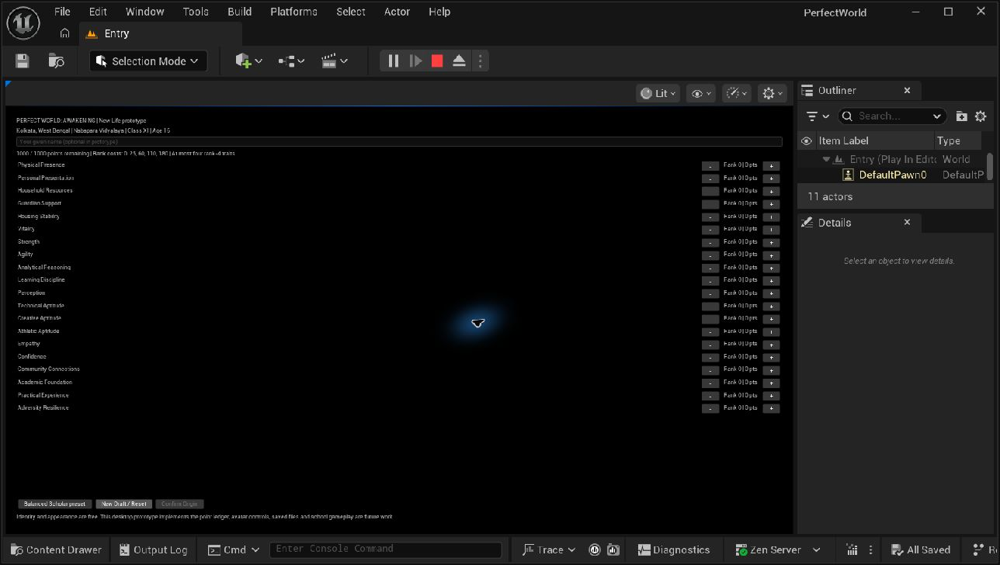

# Creator menu check — 20 September 2026

Tested the Desktop project in Unreal Engine 5.7.4, using the Entry map and Play In Editor. The editor was left open with play stopped.

| Action | Observed result |
|---|---|
| Start Play with Alt+P | Creator appeared with Kolkata, Nabapara Vidyalaya, Class XI and age 16 |
| Select Balanced Scholar | Remaining points became 0/1000; Confirm Origin enabled |
| Increase Physical Presence with no points remaining | Budget error appeared; rank stayed 1 and remaining points stayed 0 |
| Decrease Physical Presence | Rank became 0; exactly 25 points refunded; confirmation disabled |
| Increase it again | Rank returned to 1; remaining points returned to 0 |
| Confirm Origin | Confirmation message appeared; no school/city scene was claimed or loaded |
| Decrease a trait after confirmation | Rank and budget stayed unchanged |
| New Draft / Reset | All ranks returned to 0; remaining points returned to 1000 |
| Escape | Play stopped and returned to the editor |

## Limits of this check

This is a desktop mouse smoke test, not a complete accessibility, controller, touch or packaged-game test. The four-rank-4 cap remains covered by the C++ suite; it was not manually repeated here. Name entry, disk saving and mobile behavior were not verified. Disk saving is not implemented.

The menu's text and controls are small at the observed editor viewport size. Next small implementation task: improve font sizes, row spacing and narrow-window layout, then repeat this same smoke test. Do not add school/world systems in that UI-polish change.

## Source-control state

The first local commit is `f948f1f` — `Initial Unreal C++ foundation for Kolkata life RPG`. The requested private GitHub upload is pending explicit source/destination approval. Unreal-generated local configuration was not included in this documentation checkpoint.
