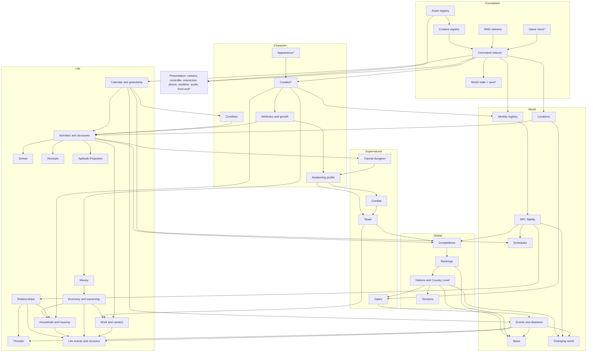

# Systems

**Document status:** systems blueprint, 2026-09-23. Detail for `GAME_PLAN.md` §6, which is the authority; where this document and `GAME_PLAN.md` disagree, `GAME_PLAN.md` wins and this document is corrected. Planning only: nothing here exists unless marked **built**. Content schemas and JSON examples are in `SYSTEMS_DATA.md`. Asset IDs, the placeholder generator and the swap contract belong to `ASSET_PIPELINE.md`.

---

## 1. Architecture principles

### 1.1 Binding rules (`MASTER_PLAN.md` §4, `GAME_PLAN.md` §6)

1. **One clock.** One monotonic `int64` game-minute `GameClock` (**built**), owned by the world state. Free roam, activities, sleep, travel and compression all move time through one reducer path, and every scheduled consequence fires from its one queue. One clock does not mean one rate (§2.5).
2. **The reducer owns truth.** Portable commands transform validated state. Unreal actors submit commands and present the results; no actor, widget or Blueprint holds authoritative state.
3. **Versioned stable-ID snapshots.** Saves are sectioned JSON keyed by stable IDs. They never contain pointers, array positions, asset paths or actor names. Each section has its own version and migration chain.
4. **Content is validated data.** Rules, careers, events, schedules, nations and scoring are JSON in `Data/Content`, checked by one loader. The game, CTest and the editor all run that same loader.
5. **Declarative schedules resolved at event boundaries.** Where a person is comes from a pure function of schedule, calendar and flags. Nobody walks around offscreen.
6. **Separated, persisted RNG.** Named streams have persisted state, and keyed draws derive from the persisted world seed. Reloading cannot reroll anything.
7. **No persistent mutation from Tick.** A ticker may *submit* `time.advance`. Only the reducer changes state.

**What makes these rules hold in C++:**
- **Integer maths only in the simulation.** `Milli` (×1000) for stats, `Paise` (`int64`) for money, minutes for time. Floats exist only in presentation.
- **No hidden nondeterminism in the core.** It never iterates `std::unordered_*` containers and never uses `std::*_distribution`, `rand` or the wall clock.
- **Outside inputs arrive explicitly.** Entropy and wall-clock time enter only as command arguments, or as save metadata that is excluded from hashes.
- **Unreal-compatible C++.** The core compiles without exceptions or RTTI (the UBT defaults) and uses `std::get_if`, never `std::get`.
- **No IO in the core.** It takes text buffers in and hands text buffers back.

### 1.2 Modules

| Module / target | Kind | Contains | Why |
|---|---|---|---|
| `PerfectWorldCore` *(exists)* | UE Runtime module + CMake static library | Reducer, all system rules, RNG, content loader, save codec, migrations | Engine-free and CTest-covered. The same source compiles in both builds, so rules are tested without the editor |
| `PerfectWorld` *(exists)* | UE Runtime module | `UPWSimSubsystem`, `UPWSaveSubsystem`, `UPWContentSubsystem`, `UPWAssetResolver`; game modes, controller, character, camera; presenters; Slate UI; audio | The only code that touches UObjects. It presents state; it never decides it |
| `PerfectWorldEditor` *(new)* | UE Editor module | Cross-layer validator commandlet, placeholder-generator hooks (`ASSET_PIPELINE.md`), asset-coverage report, level slot audit, debug windows | Editor-only APIs stay out of cooked builds |
| `Tools/` *(new)* | CMake executables | `pwcontent` (validate, bundle), `pwsave` (inspect, migrate, diff), `pwreplay` (replay, hash), `pwbench`, `pwsoak` | Agents and CTest can run them without the editor |

**Layering and file conventions:**
- **CMake enforces layers.** Core sources are split into static libraries `pw_foundation` ← `pw_character` ← `pw_life`/`pw_world` ← `pw_global` ← `pw_supernatural`, so an upward call fails to link in CTest. A CTest include-lint applies the same rule to headers. UBT still sees one module.
- **Files stay flat**, one test executable per system, per `DEVELOPMENT_WORKFLOW.md`: `Public/<System>.h`, `Private/<System>.cpp`, `Tests/<System>Tests.cpp`.

---

## 2. The command reducer

### 2.1 Key types (sketch)

```cpp
namespace PerfectWorld {
using Milli = std::int32_t;  using Paise = std::int64_t;  using Id = std::string;  // stable ID, never a pointer or path
enum class CommandSource : std::uint8_t { Player, Presentation, Performance, System, Migration, Debug };
enum class ClockMode : std::uint8_t { FreeRoam, Conversation, Scene, UiPaused, AccessibilityPause, Mission, Compressed };

// One struct per command, declared in <System>Commands.h. TypeId is the stable text written to replay logs.
struct AdvanceTime        { static constexpr std::string_view TypeId = "time.advance";        std::int64_t Minutes = 1; };
struct BeginActivity      { static constexpr std::string_view TypeId = "activity.begin";      Id Activity, Slot; bool Routine = false; };
struct SceneAct           { static constexpr std::string_view TypeId = "scene.act";           Id Action, Target; std::int64_t Value = 0; };
struct Interact           { static constexpr std::string_view TypeId = "interact";            Id Slot, Verb; };
struct ResolvePerformance { static constexpr std::string_view TypeId = "performance.resolve"; Id Instance;
                            std::vector<std::pair<Id, std::int64_t>> Metrics; std::uint32_t DurationMs = 0; };
struct ConfirmCreation    { static constexpr std::string_view TypeId = "creation.confirm";    std::uint64_t WorldSeed = 0; Id LifeId; };
using CommandPayload = std::variant<AdvanceTime, BeginActivity, SceneAct, Interact, ResolvePerformance, ConfirmCreation /* ~150 */>;
struct Command { std::uint64_t Seq = 0; CommandSource Source = CommandSource::Player; CommandPayload Payload; };

struct Rejection   { std::string Code; std::string Message; };            // Code is stable: "activity.slot_busy"
struct DomainEvent { std::uint64_t Seq = 0; GameInstant At = 0; EventPayload Payload; };  // EventPayload: std::variant<...>
struct CommandResult {
    bool Accepted = false; Rejection Why; std::uint64_t Seq = 0; GameInstant From = 0, To = 0;
    bool Partial = false;              // event cap reached; presentation submits time.continue
    std::uint64_t StateHash = 0; std::vector<DomainEvent> Events;       // emission order
};
struct WorldState {   // each member is one save section, mutated only by its owning system
    WorldMeta Meta; GameClock Clock; RngBank Rng; CreationState Creation; PlayerState Player;
    StatsState Stats; ConditionState Condition; AwakeningState Awakening; TimeControlState Time;
    ActivityState Activities; SchoolState School; CareerState Careers; MoneyState Money; EconomyState Economy;
    HouseholdState Household; RelationshipState Relationships; ThreadState Threads; ReceiptState Receipts;
    ProjectionState Projection; LifeEventState LifeEvents; LocationState Locations; IdentityRegistry Identities;
    FidelityState Npcs; ScheduleState Schedules; WorldEventState Events; NewsState News; ChangeState Change;
    NationState Nations; RankingState Rankings; CompetitionState Competitions; TensionState Tensions;
    GateState Gates; DungeonState Dungeon; TowerState Tower;
};
class WorldSim {
public:
    explicit WorldSim(std::shared_ptr<const ContentDb> content);
    CommandResult Submit(const Command& command);             // the only mutation entry point
    const WorldState& State() const noexcept;                  // read-only; never cache pointers across Submit
    SaveDocument Capture() const;  OperationResult Restore(const SaveDocument& document);
private:
    std::optional<Rejection> Validate(const Command&) const;   // pure
    void Apply(const Command&, Tx&);                           // infallible once validated
    void RunTimeTo(GameInstant target, Tx&);                   // event by event, cap 10,000
    void Route(const ScheduledEvent&, Tx&);                    // "system/kind/key" -> owning system
    void Publish(DomainEvent, Tx&);                            // FIFO, fixed subscriber order, cap 4,096
};
}
```

Each system is a namespace of free functions: `Validate`, `Apply`, `OnEvent`, `OnScheduled` and `CheckInvariants`. A system receives its own slice non-const and every other slice const. `SimWiring.cpp` is the one table that says which system consumes which event, and in what order.

### 2.2 The Submit pipeline

1. **Validate** (pure). A rejection returns a stable code, changes nothing and is not logged.
2. **Apply.** The owning system mutates its own slice. Anything that affects another system becomes a `DomainEvent`, queued FIFO and delivered in wiring order.
3. **Advance time.** A command that costs time calls `RunTimeTo`:

   ```
   while (next = Clock.NextEventInstant()) <= target:
       advance to next
       FireDue(): route each due event in (When, Phase, Handle) order, then drain
   advance to target
   ```

   Handlers may schedule anything at or after now, including inside the remaining window, and it fires in the same pass. After 10,000 fired events the result is marked `Partial` and presentation resubmits `time.continue`, so a year skip never freezes a frame.
4. **Check invariants** (debug and test builds).
5. **Commit.** `Seq++`, append to the command log, fold into the state hash, return the events.

Scheduled IDs follow `system/kind/key` (for example `activities/complete/act_412`, `calendar/midnight/-`, `events/onset/howrah_b_incursion_2042_11`). Payloads live in the owner's slice keyed by handle, so the clock stays ignorant of every system.

### 2.3 The Unreal bridge

- **`UPWSimSubsystem`** (a GameInstance subsystem) owns `WorldSim`. It is the only caller of `Submit` and runs on the game thread only.
- **Typed Blueprint libraries** such as `UPWActivityLibrary::BeginActivity` return `FPWCommandResult{bAccepted, FName Code, FText Message}`. New systems report stable `FName` codes; the mirrored-UENUM pattern (`EPWCreationError`) stays only on the creation façade, because mirroring roughly 45 enums would drift.
- **Presenters** subscribe to a native `OnSimEvent` multicast and re-read views after each event.
- **Free roam:** an `FTSTicker` counts unpaused real time and submits `time.advance{1}` once per whole real second. The HUD interpolates the minute it displays.
- **Compression** (week, season, year) runs `Submit` on a `UE::Tasks` worker while the game thread shows the resolution screen and queues nothing.

### 2.4 Determinism and replay

- **Additivity.** `advance{a}` followed by `advance{b}` equals `advance{a+b}`. Integer per-minute rates and event-by-event stepping make this exact. The log therefore coalesces free-roam minutes: an hour's walk is one entry, not 3,600.
- **State hash.** FNV-1a 64 over each section's canonical bytes — the save writer's own output, with fixed field order, maps sorted by ID and integers only — combined in section order. It is stored in every save, and in the log every 256 commands.
- **Replay files** hold the start save (or creation), the content hash, the commands and the checkpoint hashes. `pwreplay` reports the first sequence number and section that diverge. Development builds log whole sessions to `Saved/Replays/`. Saves carry the log since the last checkpoint (at most 1 MB) for bug reports.
- **Direct-control performances** (§2.6) replay from their recorded result, not from frames.

### 2.5 The time contract: one clock, declared rates

| Mode | World clock | Examples | Charged |
|---|---|---|---|
| `free_roam` | Runs, 1 game minute per real second | Walking, looking, waiting | `time.advance{1}` each real second |
| `conversation` | Paused | Dialogue | Nothing, or the declared cost per exchange, at `talk.close` |
| `scene` | Paused while played | Classes, shifts, repairs, travel, sleep | The declared `costMinutes`, at the resolution boundary |
| `ui_paused` | Paused | Phone, planning, receipts, news, menus | Never |
| `accessibility_pause` | Paused | Pause, text speed, subtitle changes | Never |
| `mission` | Paused; the mission clock runs | Tutorial dungeon, tower, combat, Gate operations | At exit: `fixedMinutes`, or mission minutes × rate, capped at `capMinutes` |
| `compressed` | Jumps event by event | Routine week, season, year | The span resolved |

**Every interaction declares its time contract:** `clock{mode, cost, interrupt: none | at_beat | immediate, resolve: on_commit | on_complete | per_beat}`. The validator rejects any that lacks one.

**Rules:**
1. **Free time is free.** Reading, planning and accessibility adjustments never consume opportunity time.
2. **Equivalence.** A plan resolved as scenes played with routine choices, as a routine week, as a season or as a year produces the same persistent outcome unless the player decides differently. One resolution path (`ResolveRoutine`) and keyed per-day RNG make this true, and §8 tests it.
3. **Disclosure.** Compression decides only through the player's standing orders, and each such decision appears on the receipt as `decided_by_order`. A consequential choice that no order covers stops compression (it becomes the week's one interrupt) or turns into a nominated scene day.
4. **Interruption.** `at_beat` interrupts wait for the next beat. `immediate` interrupts — a breach on the player's street — end the activity and charge the elapsed minutes pro rata.

### 2.6 Embodied play layers

| Layer | Examples | Owner of truth | Runs in |
|---|---|---|---|
| **Direct control** | Movement, sport execution, combat, hands-on manipulation | `PerformanceDef` data and portable scoring; result via `performance.resolve` | UE controller and performance runner, frame-driven |
| **Contextual interaction** | Sit, pick up, use, talk | Locations (slots) and Activities | UE targeting, then `interact{slot, verb}` |
| **Four-structure problems** | Explain, model, investigate, coordinate | The Activities structure engines | Core; UE draws the board |
| **Routine resolution** | Mastered periods, routine weeks, seasons | Activities `ResolveRoutine` with Calendar | Core only |

**A path's decisive moments use the layer their verbs need.** An athlete paces, feints and positions under direct control, plans tactics as a coordinate problem, and resolves training volume as routine. The validator requires every path to include foreground activities; no career may be routine only.

**The character sets the envelope; the player executes inside it.** Capability decides top speed, precision window and stamina — the physical twin of the school rule that the character determines methods and cost while the player decides how to apply them.

**Performance results are bounded inputs.** A `PerformanceResult{Instance, Metrics, DurationMs, InputDigest}` is rejected if any metric falls outside the definition's bounds or the character's envelope. What happens mid-performance is transient: reloading restarts the performance.

---

## 3. Systems (moved)

Moved to `SYSTEMS_CATALOGUE.md` to keep this file under 500 lines. Section numbers are unchanged there.

## 4. Dependency graph and build order

An arrow from A to B means B reads A's state or consumes its events, so A is built first. Runtime feedback loops — casualties feeding the containment rate, which feeds Country Level — travel through domain events and are not drawn. Foundation underlies every system. `*` marks what is built.



**Build order**, derived from the graph and aligned with `GAME_PLAN.md` §8:

| Milestone | Systems |
|---|---|
| **M0** | Verify what is built — clock, appearance, creation, v4 save, front end. No new systems |
| **M1** | RNG → content registry → asset registry → command reducer → world save v5 → locations → identity registry (player and family) → camera, controller, interaction, block renderer |
| **M2** | Calendar (day) → condition → growth → activities (model a system) → school (one day) → money (fares) → economy (inventory) → household (one origin) → NPC tier 0 → schedules → relationships → receipts → phone (calendar and receipt) → the identity, stream and review screens |
| **M3** | The other three structures → calendar (week, festivals) → Aptitude Projection → threads → six origins → events (authored) → news → nations (static) → Gates (incidents, district risk) → audio |
| **M4** | Tutorial dungeon → awakening → combat → tower → countdown → exam rank → credentials |
| **M5** | Careers → full money and economy → housing → full relationships → life events → season and year compression → ageing → Class XII, board examinations, university → local competitions and rankings |
| **M6** | NPC tiers 1–3 and crystallisation → national competitions and rankings → generated events and the twelve mechanisms → Gates live → changing world (institutions, businesses) |
| **M7** | Thirty nations and Country Level live → the Convergence → tensions → first foreign location → global notable figures |
| **M8** | All paths → enterprises → retirement → changing world across decades → the epilogue |
| **M9** | Resolver swap only |
| **M10** | Performance, accessibility, localisation (`Data/Text`) |

---

## 5. Content data

All schemas and a JSON example for each are in **`SYSTEMS_DATA.md`**: problem families in the four structures, paths and careers, activities, world events, thread templates, nations, competitions, cohort models, schedules, locations and interaction profiles, and life-event templates.

- **Files and IDs.** Content lives in `Data/Content/<type>/<id>.json`, one record per file, with display text in `Data/Text/<locale>/`.
- **One validator.** `ContentRegistry::Load` checks shape, references and semantics in one C++ implementation. The game runs it at boot, `pwcontent validate` runs it in CTest, and the editor commandlet `-run=PWValidateContent` adds the cross-layer pass: asset IDs, anchor bounds and placed slots.
- **Shipping.** Cooked builds load one validated `content_bundle.json`, staged by `RuntimeDependencies`.

---

## 6. Save architecture

**File lineage.** File schema **v5** is the first world envelope, continuing the creation file lineage (v1–v4 were creation-only files). Each section is versioned independently from v1, except `creation`, which continues its own lineage at v5.

```json
{ "format": "perfectworld.save", "schemaVersion": 5, "build": "0.2.0+abc1234", "savedAtUtc": "2042-06-04T19:20:00Z",
  "summary": { "name": "Ananya Sen", "age": 16, "gameTime": "2042-06-04T19:20", "phase": "latent_life", "locationKey": "loc.nabapara_vidyalaya" },
  "recap":   { "lastAction": { "textKey": "recap.attended_physics", "args": [] }, "commitments": [ { "id": "unit_test_physics", "due": "2042-06-09T10:00" } ],
               "openThreads": ["thr_12"], "location": "loc_nabapara_vidyalaya", "gameTime": "2042-06-04T19:20" },
  "resume":  { "point": "in_world", "map": "<map asset id>", "location": "loc_nabapara_vidyalaya", "zone": "gate",
               "posCm": [120, -3400, 20], "yawCdeg": 9000, "camera": "first_person", "clockMode": "free_roam" },
  "meta":    { "lifeId": "life_7f3a", "worldSeed": "0x5e1f9a0c33d2b7e1", "contentHash": "0x91c0e2d4", "commandSeq": 18234 },
  "hashes":  { "state": "0x0b41c7e2a9d35f60", "sections": { "clock": "0x77aa01c3" } },
  "sections": { "creation": { "v": 5 }, "clock": { "v": 1 }, "rng": { "v": 1 }, "stats": { "v": 1 } } }
```

**Sections and hashing.** There is one section per system in §3, written in a fixed order in canonical form — which is also what the state hash reads. The header comes first, so the Load and Continue screens and the "since you last played" recap read only the header. The recap holds the last action, current commitments (up to three), date, location and open threads (up to three).

**Migration.** Each step is a pure `JsonValue → JsonValue` function, registered per (section, from-version), applied in memory; the original file is never rewritten.
- **From v4:**
  - The old record becomes `sections.creation`, with its fields unchanged plus `identityIncomplete: true`, which sends the player to the Identity screen.
  - If `hasStarted`, the world is built by applying `creation.confirm` with `WorldSeed = FNV-1a 64(canonical v4 text)`, so migrating twice gives the same world. The life opens at 06:00 on 2 June 2042.
  - The legacy file becomes `.v4.bak` only after the first successful v5 write.
  - `MinSupportedSaveVersion` stays at 1.
- **Content drift.** Saves record `contentHash`. On a mismatch, aliases are applied, new sections take their defaults, and authored events whose onset has already passed do not fire unless flagged `retroactive`.

**Life slots and recovery checkpoints.** Slots are lives; checkpoints are a way back within one life. Writes use the existing temp-file-then-move protocol, and re-parse the file before replacing anything.

| File (per slot, `Saved/SaveGames/slot_N/`) | Role |
|---|---|
| `life.json` | The life slot: the latest manual save or checkpoint. The Load screen shows three |
| `life.prev.json` | The known-good previous write |
| `checkpoint_1..3.json` | Rotating recovery checkpoints, offered as "return to an earlier point", never as slots |
| `replay.json` (dev builds) | The command log since the last checkpoint |

**Checkpoint policy:**
- **Automatic checkpoints** are taken:
  - on waking after sleep;
  - on each map change;
  - after each week, season or year resolution;
  - on entering the tutorial dungeon, each tower floor and any mission;
  - after examination results;
  - after 15 real minutes of free roam, at the next quiescent moment.
- **Manual saves** are allowed whenever the reducer is quiescent and the clock mode is not `mission`. Quitting mid-mission resumes at mission entry.
- **A closed life** keeps its slot as a read-only epilogue until the player deletes it.

**Size and time budgets:**

| Point in the life | Size budget |
|---|---|
| M2 | ≤ 100 KB |
| M4 | ≤ 400 KB |
| Age 30 | ≤ 3 MB |
| Age 80 | ≤ 8 MB |
| Hard failure | 16 MB |

- **At age 80, by section:** identities ≤ 2 MB, npcs ≤ 1.5 MB, relationships ≤ 0.8 MB, receipts ≤ 0.6 MB, events and news together ≤ 1.2 MB, rankings ≤ 0.5 MB, nations ≤ 0.4 MB, everything else ≤ 1 MB.
- **Timing:** serialising 8 MB takes ≤ 80 ms at a checkpoint, hidden by its transition, and the file write runs on a background thread. Loading takes ≤ 400 ms.

---

## 7. Performance and scale budgets

The reference PC is for the owner to nominate. These budgets assume a 6-core 2019-class CPU (Ryzen 5 3600 or Core i5-10400), 16 GB of RAM, a GTX 1660 Super-class GPU and an SSD, at 1920×1080.

| Population | Count | Update | CPU per update | Save |
|---|---|---|---|---|
| Tier 0, active local cast | ≈50 (hard cap 64) | Weekly, plus live `WhereIs` in the player's hub | ≤ 6 ms a week | ≤ 8 KB each |
| Tier 1, significant | ≈500 (soft cap 500; hard cap 1,000 by LRU demotion) | Monthly | ≤ 15 ms a month | ≤ 1.5 KB each |
| Global notable figures | ≈240 (3–8 × 30) | Seasonal | ≤ 5 ms a season | ≤ 1 KB each |
| Tier 2, cohorts | 1,800 parametric cells (30 × 10 × 6) | Seasonal | ≤ 3 ms a season | ≤ 60 KB |
| Tier 3, aggregates | 30 × ~24 series | Continuous inputs, quarterly publication | ≤ 1 ms a quarter | ≤ 300 KB by age 80 |
| Identity registry | ≤ 25,000 people by age 80 | Append-only | ≤ 50 µs per registration | ≤ 80 B each |

**Thirty-nation seasonal update: ≤ 40 ms in total, single-threaded.**

| Part | Budget |
|---|---|
| Cohort drift | 3 ms |
| Notable figures | 5 ms |
| Statistical championships (30 × 10 × 3 × 64 = 57,600 draws) | 10 ms |
| Rankings recompute | 10 ms |
| Country Level and aggregates | 5 ms |
| Hazards | 5 ms |

**Compression:** a routine week ≤ 150 ms, a season ≤ 400 ms, a year ≤ 1.5 s. A non-time command averages ≤ 50 µs. The clock queue holds at most 5,000 events. The CTest soak — ages 16 to 80 under a scripted policy — must finish in ≤ 120 s in Release.

**Frame budget — first-person free roam in the Nabapara hub, block visuals, 1080p60:**

| Item | Budget |
|---|---|
| Frame | 16.6 ms |
| Game thread | ≤ 6 ms, of which the simulation bridge ≤ 0.5 ms on average and ≤ 2 ms at an event boundary |
| Render thread | ≤ 7 ms |
| GPU | ≤ 13 ms |
| Draw calls | ≤ 2,000 (props on ISM/HISM, static block kits merged) |
| Visible triangles | ≤ 2 M (a block is 12) |
| Animated block characters | ≤ 40 within 40 m; ≤ 24 at full update rate (URO beyond 15 m); ≤ 80 visible including an instanced distant crowd |
| Texture pool | ≤ 512 MB |
| Process memory | ≤ 4 GB |
| Interior load behind a door | ≤ 200 ms |
| Hitches | At most one frame over 33 ms per 10 minutes |

**Lighting and features:** one movable sun with 3 cascades to 80 m, a sky light, and at most 8 shadow-casting lights per interior. No Lumen, Nanite, World Partition or MetaHuman (`MASTER_PLAN.md` §4). Measure before changing any of this.

---

## 8. Testing strategy

| Layer | What | Runs |
|---|---|---|
| **Unit** | Every handler, engine and formula; one test executable per system | CTest on every change (rung 1) |
| **Property** | 10,000 seeded command sequences per system, checking invariants: money conservation, condition bounds, exactly-once firing, additivity, best-four, first-act-only relationships, receipt `KnownAt` | CTest; 100× more seeds nightly |
| **Fuzz** | Save reader (every prefix, byte flips, random JSON); content loader (mutated files); validators (random arguments) | Seeded in CTest; libFuzzer on clang-cl nightly |
| **Migration** | Fixtures for every file version (creation v1–v4, world v5 onward) and every section version, checked load → migrate → save → reload byte-identical. Fixtures are kept forever | CTest |
| **Determinism and replay** | Golden replays with checkpoint hashes. Save → load → continue equals an uninterrupted run. **Granularity equivalence:** a scripted eight-week plan resolved as days, as weeks and as one season gives equal hashes for every persistent section (all except `receipts` and `time`). **Cross-build:** the same replays run in UE automation (`PerfectWorld.Replay.*`, `-nullrhi`) and must match the CTest hashes | CTest; UE automation at rung 2 |
| **Content** | `pwcontent validate`; the cross-layer commandlet | CTest; rung 2 |
| **Performance** | `pwbench` thresholds from §7; the 16-to-80 soak | Nightly, Release |
| **UE automation** | Subsystem wiring, commands submitted from the Blueprint libraries, presenter reconciliation on a fixture level | Rung 2 |
| **Play In Editor only** | Camera feel and comfort options; targeting parity between first and third person; readability of block faces at conversation distance; animation on block characters; streaming hitches; controller navigation of every screen and the phone; audio; the M4 blind-test gate | Rung 3 |
| **Cooked** | No editor dependencies; the content bundle is staged; an Unreal Insights capture on the reference PC | Rung 4, at milestones |

---

## 9. Risks

| Risk | Mitigation |
|---|---|
| The reducer becomes a monolith: ~150 commands in one variant, slow compiles, merge conflicts | Per-system command headers; the variant is assembled in one generated file; CMake layer libraries; include-lint |
| CTest and UE builds hash differently (compiler flags, floats, containers, std distributions) | Integer-only simulation; in-house RNG; a banned-token lint over core sources; cross-build replay hashes at rung 2 |
| Save growth and migration debt across 64 in-game years | Per-section versions; fold rules defined with each system; the 8 MB soak gate; permanent fixtures |
| Content renames silently break old saves | The alias table; the validator fails when an ID referenced by any fixture disappears; `contentHash` in every save |
| Presentation drifts from truth (an NPC in the wrong place, the player's transform disagreeing with their zone) | Presenters rebuild from views on events; zone triggers are commands; a debug overlay shows the reducer's truth; a PIE reconciliation test |
| Direct-control results become an unvalidated input channel | Metrics bounded by the definition and the character's envelope; performances are transient; results are logged and replayed |
| Year skips stall or storm | Event caps with `Partial`; worker-thread batches; `pwbench` gates |
| Crystallisation contradicts the record | Immutable facts; keyed RNG only; backfill bounded by the reference instant; a demote-then-promote equality test |
| Granularity equivalence erodes as systems are added | A CTest gate from M3; anything resolved during compression must draw keyed per-day RNG |
| The hand-written JSON reader does not scale (`int32` only, ASCII `\u` only) | Generalise it once into a fuzzed DOM before v5 ships |
