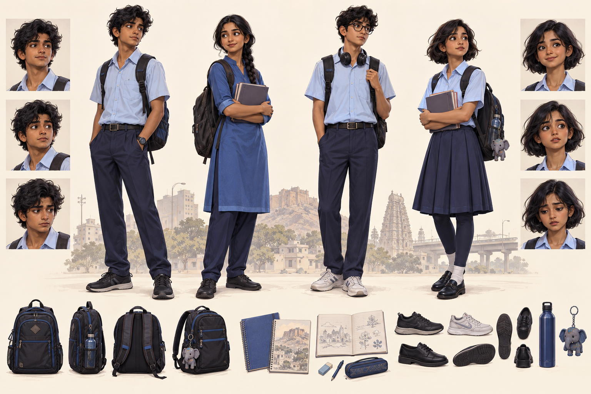

# Perfect World: Awakening

**Starter project — Kolkata, West Bengal • Age16 • Class XI • 1,000 creation points**

Live ordinary school and family life while your actions gradually shape extraordinary abilities. The working title comes from the supplied concept. The opening now uses real **Kolkata** with fictional **Nabapara** and **Nabapara Vidyalaya**. The first playable scope is one neighborhood; West Bengal and then India form the expansion plan.

## What is included

- Unreal Engine5.7 C++ project and a small native Slate character-creation menu.
- Portable C++20 rules:20 traits, ranks0–4, cumulative costs0/25/60/110/180,1,000-point budget, maximum four rank-4 traits, exact age16, free identity/cosmetics, reversible draft edits and validation.
- One implemented1,000-point Balanced Scholar preset. Other documented presets and all trait gameplay effects are design specifications for future work.
- Five free, point-cost-free household templates (parent, extended family, grandparent, adult sibling, appointed guardian), selected at Household Resources Ranks 1–4 and locked once the prologue starts. As of a 2026-09-20 design decision, Household Resources Rank 0 now means institutional care (a children's home) instead of an ordinary baseline — see Docs/CHARACTER_CREATION.md and Docs/STATUS.md. The home scenes and art for every one of these six outcomes do not exist yet.
- Versioned creation records, serialized as text by stable trait ID, saved to three local JSON slots under `Saved/SaveGames/`. This is disk save/load for the creation record only, not a complete long-term life save system, and it has not yet been checked through a Play-In-Editor smoke test.
- Detailed game design, creator specification, Bengal world bible, names, Unreal architecture, art direction, production plan and small-step queue.
- Two generated concept sheets: Kolkata neighborhood and student costumes. They are reference art, not playable3D assets.

Private GitHub repository: [debdutta777/Perfect-World](https://github.com/debdutta777/Perfect-World).

## Start here

**First time in Unreal? Follow [UNREAL_QUICKSTART](Docs/UNREAL_QUICKSTART.md).** It walks through building, opening the project and checking the creator controls.

1. Read [NEXT_SMALL_STEPS](Docs/NEXT_SMALL_STEPS.md) to keep work bounded.
2. Follow [BUILD_GUIDE](Docs/BUILD_GUIDE.md) for standalone tests and Unreal compilation.
3. Read [GAME_DESIGN](Docs/GAME_DESIGN.md), [CHARACTER_CREATION](Docs/CHARACTER_CREATION.md) and [INDIA_WORLD_BIBLE](Docs/INDIA_WORLD_BIBLE.md).
4. See [NAMING](Docs/NAMING.md), [TECHNICAL_ARCHITECTURE](Docs/TECHNICAL_ARCHITECTURE.md), [ART_DIRECTION](Docs/ART_DIRECTION.md) and [PRODUCTION_PLAN](Docs/PRODUCTION_PLAN.md).
5. Check [STATUS](Docs/STATUS.md) for exactly what has been verified.

## Current boundary

**Intended flow (design, not yet fully built or verified):** a title screen (New Game / Load Game / Settings / Exit) leads New Game into a full 2D/2.5D anime-styled appearance editor, then point allocation including household (with Household Resources Rank 0 now meaning institutional care rather than an ordinary baseline), then into a starting room chosen by the confirmed household template and rank. See Docs/STATUS.md for the 2026-09-20 decisions behind this and Docs/NEXT_SMALL_STEPS.md for the step queue that builds toward it.

**What actually exists today:** the menu edits the budget, offers a household choice, and confirms an origin record that can be saved to and loaded from one of three local JSON slots. There is no title screen, no appearance editor, and no household-dependent starting room yet — those are the intended flow above, not built. The menu does not load a playable school, room or city. School timetable simulation, aging, combat, quests and cross-platform packages are future steps. The project has no map or imported3D content beyond the engine's blank Entry map, and no home kit named by a household template (or the planned institutional-care outcome) exists yet as art or a level. There is no packaged or cooked build. Standalone test success does not prove UI usability or device performance, and the title screen, appearance editor, playable starting room, and the existing household picker and save-slot buttons have none of them had a visual Play-In-Editor smoke test.

Windows is the development host. Android performance and touch are early planned gates; other platforms need their own tooling and tests. See the architecture document for Epic documentation and limits.

## Model workflow

Use **GPT-5.6 Sol** for small routine tasks, **Claude Sonnet** for complementary design/content/review, and **Claude Opus** only for difficult work when authorized and available. The project AGENTS.md captures this preference; it does not change global application model settings. Work one small change at a time with an explicit check. Model execution notes are in STATUS.md.

## Art

See [ART_PROVENANCE](Docs/ART_PROVENANCE.md) for generation notes and the student sheet's noncanonical background.
